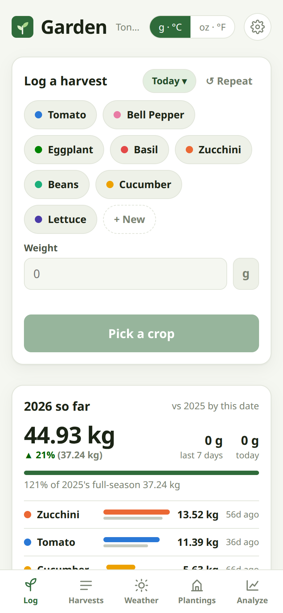
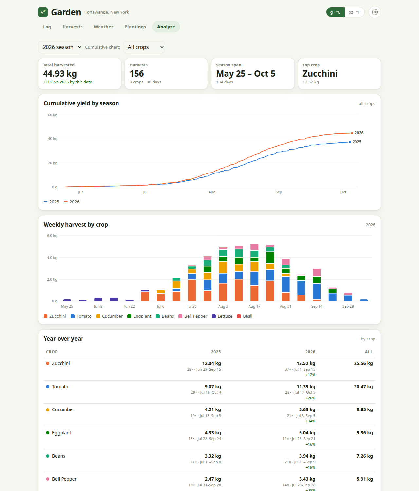
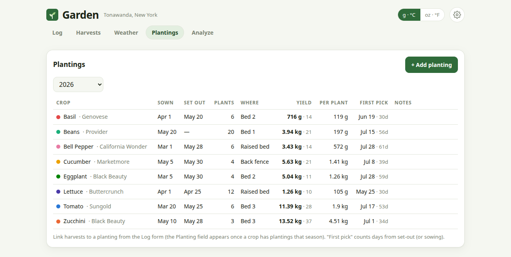

# Garden Tracker

A small self-hosted app for logging garden harvests, recording daily weather,
and comparing yields year over year. FastAPI + SQLite backend and one static
vanilla-JS page. Runs under systemd in a Debian LXC (reachable on the LAN as
**http://garden.local**) or as a Docker container. No accounts — local network only.

<p>
  
  &nbsp;
  
</p>



<sub>Screenshots use generated demo data.</sub>

## What it does

- **Log** — phone-first harvest entry: tap a crop, punch the weight on a big
  keypad (touch screens; a normal input with a mouse), Save. Shows the crop's
  typical pick and warns when a weight looks like a unit slip. Saves and deletes
  show an Undo toast instead of a confirm dialog. "Repeat" copies the previous
  entry's crop/variety/planting.
- **Season so far** (on the Log page) — season total vs last year *by the same
  date*, last 7 days, today, and per-crop bars with days since the last pick.
  Crops overdue against their usual picking interval are flagged "check".
- **Harvests** — day-grouped list with season/crop filters, search, edit/delete, CSV
  export, and CSV import (accepts the Notion export: `Date, Crop, Weight (g)`).
- **Weather** — one row per day: high, low, rain, sunshine, harvest total, notes.
  Fetched automatically from [Open-Meteo](https://open-meteo.com) (free, no key)
  every morning; a one-time backfill fills history. Tap a day to correct values
  or add a note ("frost", "hail"); edited days are marked *manual* and never
  overwritten.
- **Plantings** — sow date, set-out date, plant count, location. Harvests linked
  to a planting give yield per plant and days-to-first-harvest.
- **Analyze** — per-season stat tiles, cumulative yield curves by season (all
  crops or one crop), weekly stacked columns by crop, a crop × season YoY table
  with % change, growing degree days by season, frost dates, monthly weather.
- **Settings** — location search (geocoded), units, backfill, crop colours,
  archive/rename/delete crops, manage varieties.
- Metric ⇄ imperial toggle (g/°C/mm vs oz·lb/°F/in). Everything is stored metric.
- Live updates between devices via server-sent events.

## Layout

```
app/          FastAPI backend
  main.py       routes            db.py        SQLite schema + CRUD
  models.py     Pydantic models   config.py    paths + GARDEN_* env vars
  weather.py    Open-Meteo fetch + daily scheduler
  analytics.py  YoY / season / GDD queries
  events.py     SSE pub/sub for live updates between devices
  importer.py   CSV import/export   seed.py    `python -m app.seed`
web/          index.html + app.js (no build step, no CDN dependencies)
tests/        pytest suite (API tests against a temp database)
data/         garden.db (created on first run), seed/garden_produce.csv
deploy/       install.sh, garden.service, garden.env.example, backup.sh
Dockerfile, compose.yaml, docker-entrypoint.sh   Docker image
```

## Run locally

```bash
python3 -m venv venv && venv/bin/pip install -r requirements.txt
venv/bin/python -m app.seed                      # optional: import data/seed/*.csv
venv/bin/uvicorn app.main:app --reload --timeout-graceful-shutdown 2 --port 8000
```

Open http://localhost:8000. Weather starts backfilling a couple of seconds after
boot (see the Weather tab's status line).

Run the tests:

```bash
venv/bin/pip install -r requirements-dev.txt
venv/bin/pytest
```

## Run with Docker

```bash
git clone https://github.com/rodavok/garden_tracker && cd garden_tracker
docker compose up -d --build
```

Open http://localhost:8000 (or `http://<host-ip>:8000` from another device).
To publish on port 80 instead, change the `ports:` line in `compose.yaml` to
`"80:8000"`. The container doesn't announce itself over mDNS, so `garden.local`
won't resolve unless you add a DNS entry for the host.

- **Data** lives in the `garden-data` volume, mounted at `/data`. On the first
  start, with no database yet, the container imports `data/seed/garden_produce.csv`.
  Set `GARDEN_SEED: "0"` to start empty instead.
- **Configuration** goes in the `environment:` block of `compose.yaml`, using
  the same `GARDEN_*` variables as below. Set `GARDEN_TZ` to your time zone so
  the daily weather fetch runs at the right local hour.
- **Updating:** `git pull && docker compose up -d --build`. The volume is kept.
- **Backups:** `docker compose exec garden deploy/backup.sh` writes to
  `/data/backups` inside the volume. To schedule it, put that command in the
  host's crontab. Copy the backups out with
  `docker compose cp garden:/data/backups ./backups`.
- **Restoring:** stop the app, then unpack a backup from the current folder
  into the volume with a one-off container. The container also removes stale
  WAL files and fixes ownership:

  ```bash
  docker compose stop
  docker compose run --rm --user root -v "$PWD:/restore" garden sh -c \
    'gunzip -c /restore/garden-YYYYMMDD-HHMMSS.db.gz > /data/garden.db &&
     rm -f /data/garden.db-wal /data/garden.db-shm && chown garden:garden /data/garden.db'
  docker compose start
  ```
- To keep data in a host folder instead of a named volume, use
  `./data-docker:/data` under `volumes:` and run `sudo chown 1000:1000 data-docker`
  first. The app runs as UID 1000 inside the container.

Without Compose:

```bash
docker build -t garden-tracker .
docker run -d --name garden --restart unless-stopped -p 8000:8000 \
  -v garden-data:/data -e GARDEN_TZ=America/New_York garden-tracker
```

## Deploy to a Proxmox LXC

1. Create an unprivileged Debian 12 (or Ubuntu 24.04) container, hostname
   **garden**, on your LAN bridge. 1 core / 512 MB / 4 GB is plenty. Give it a
   fixed address, either a DHCP reservation on the router or a static IPv4 in
   Proxmox (Network tab), and set IPv6 to static/none unless you use it.
   Make sure it has outbound internet for the weather fetch.
2. Inside the container, as root:

   ```bash
   apt-get update && apt-get install -y git
   git clone https://github.com/rodavok/garden_tracker /opt/garden
   /opt/garden/deploy/install.sh
   systemctl enable --now garden
   ```

   (For a private repo, clone with a token or copy the folder in with `pct push`.)
3. Open **http://garden.local** from anything on the LAN. mDNS is provided by
   `avahi-daemon`, which the installer enables; Windows, macOS, iOS, Android and
   most Linux desktops resolve `.local` names out of the box. If your router or
   Pi-hole does local DNS instead, point `garden.local` (or any name) at the
   container's IP there.

   If `garden.local` stops resolving now and then, run
   `journalctl -u avahi-daemon -n 50` in the container. "fork() failed" means
   the process limit shared with other containers (the installer removes it);
   "host name conflict" means it renamed itself to `garden-2.local`.
4. Settings → confirm the location (defaults to Tonawanda, NY) and let the
   backfill run.

Updating later:

```bash
cd /opt/garden && git pull && venv/bin/pip install -r requirements.txt && systemctl restart garden
```

### Configuration

`/etc/garden/garden.env` (see `deploy/garden.env.example`) — all optional:
`GARDEN_LAT`, `GARDEN_LON`, `GARDEN_LOCATION`, `GARDEN_TZ`,
`GARDEN_BACKFILL_START`, `GARDEN_WEATHER_HOUR`, `GARDEN_WEATHER=0` (disable
fetching), `GARDEN_DATA` / `GARDEN_DB` (store the database elsewhere).

### Backups

`deploy/backup.sh` makes a consistent gzip copy of the SQLite file using the
online-backup API and prunes all but the newest `GARDEN_BACKUP_KEEP` (default
30). Nightly at 03:15:

```
15 3 * * * GARDEN_BACKUP_DIR=/mnt/backups/garden /opt/garden/deploy/backup.sh
```

(`crontab -u garden -e`). Restoring is `gunzip -c garden-….db.gz > data/garden.db`
with the service stopped.

## API

All under `/api`, JSON. Useful ones for scripting:

| Method | Path | |
|---|---|---|
| GET/POST | `/harvests` | filters: `season`, `crop_id`, `start`, `end`, `limit` |
| PATCH/DELETE | `/harvests/{id}` | |
| GET | `/harvests/last` | for "repeat last" |
| GET/POST, PATCH/DELETE | `/plantings`, `/plantings/{id}` | includes computed yield stats |
| GET/POST, PATCH/DELETE | `/crops`, `/varieties` | |
| GET | `/weather?start=&end=` | |
| PUT/DELETE | `/weather/{date}` | manual override / reset to auto |
| POST | `/weather/refresh`, `/weather/backfill` | |
| GET | `/stats/overview`, `/stats/season/{year}`, `/stats/pulse`, `/stats/cumulative?crop_id=`, `/stats/gdd` | `pulse` = "Season so far" card |
| GET | `/seasons` | years with data |
| GET/PATCH | `/settings` · GET `/geocode?q=` | location, backfill start, weather status |
| POST | `/import/csv` (multipart `file`) · GET `/export.csv` | |
| GET | `/events` (SSE) · `/health` | |

Interactive docs at `/docs`.

## Home Assistant

[`deploy/homeassistant/garden.yaml`](deploy/homeassistant/garden.yaml) is a
Home Assistant [package](https://www.home-assistant.io/docs/configuration/packages/).
It polls `/api/stats/pulse` every 5 minutes and adds:

| Entity | State | Attributes |
|---|---|---|
| `sensor.garden_today` | grams picked today | `today_picks` |
| `sensor.garden_last_7_days` | grams in the last 7 days | |
| `sensor.garden_season` | season total | `prev_to_date_g`, `prev_total_g` |
| `sensor.garden_vs_last_year` | % change vs last year by the same date | |
| `sensor.garden_crops_to_check` | number of crops flagged "check" | `crops` (full per-crop list) |

It also adds an automation that sends a notification at 17:30 when any crop is
overdue, e.g. "Beans (4 days since last pick)".

1. In `configuration.yaml`, enable packages if you haven't already:

   ```yaml
   homeassistant:
     packages: !include_dir_named packages
   ```
2. Copy `garden.yaml` to `<config>/packages/garden.yaml` and change the two
   lines marked `CHANGE ME`: the URL (`http://<host-ip>:8000/...` for Docker)
   and the notify service (your phone's `notify.mobile_app_…`).
3. Developer Tools → YAML → Check configuration, then restart Home Assistant.

The weight sensors use the `weight` device class, so Home Assistant shows them
in ounces or pounds if your system uses imperial units. A dashboard card that
lists this season's crops:

```yaml
type: markdown
title: Garden
content: |
  
  **{{ states('sensor.garden_today') }} {{ u }} today** ·
  {{ states('sensor.garden_season') }} {{ u }} this season
  ({{ states('sensor.garden_vs_last_year') }}% vs last year)

  
  
  - {{ c.name }}: {{ c.season_g }} g{{ ' ⚠ check' if c.due }}
  
  
```

The app has no authentication, so don't expose it to the internet just so
Home Assistant Cloud or the companion app can reach it away from home. The
sensors work fine with Home Assistant polling it on the LAN.

## Notes

- Growing degree days use base 10 °C with the daily max capped at 30 °C.
- "Frost" = a day whose low is ≤ 0 °C. Last spring frost is the latest before
  July 1; first fall frost the earliest on/after July 1.
- The weather backfill starts at `backfill_start` (default 2025-08-01). Run it
  from an earlier date in Settings if you want full-year frost/GDD comparisons.
- Open-Meteo's archive lags ~5 days; the last week is filled from the forecast
  API and corrected on later refreshes. Manually edited days are left alone.
